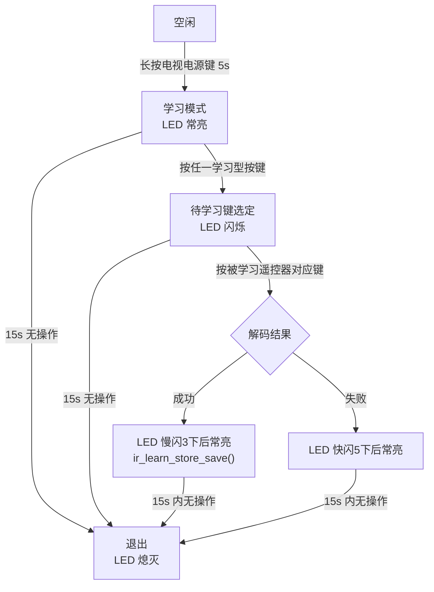
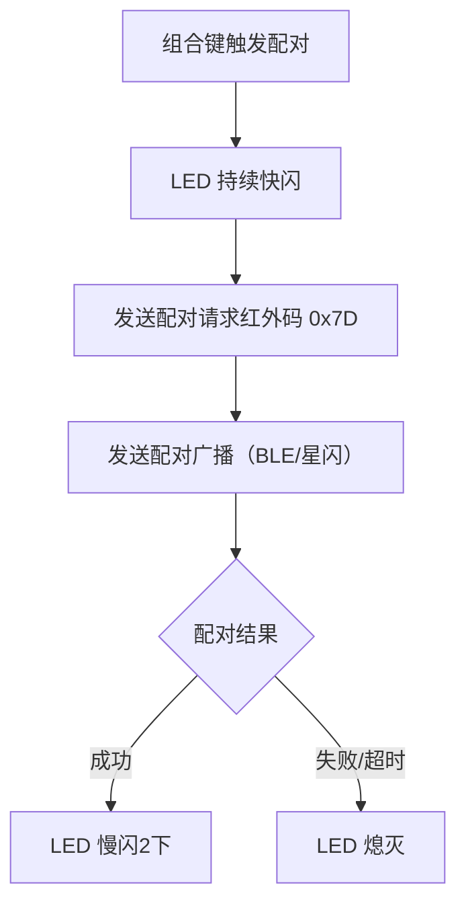

# 红外调用实现规格（GY/T 407-2024）

> **状态**：随集成进展持续更新  
> **依据**：《GY/T 407-2024 机顶盒通用遥控技术要求和测量方法》  
> **配套文档**：[irc_implementation_plan.md](irc_implementation_plan.md)（IRC 硬件方案）  
> **目的**：本文档定义红外功能在按键系统里的**调用逻辑**——组合键、使用时机、状态机、LED 指示、按键路由，作为 `task_keyscan.c` / `combo_key.c` 集成的依据。

---

## 一、红外使用场景总览

| 场景 | 标准章条 | 触发方式 | 红外动作 |
|------|---------|---------|---------|
| 开机 | 5.1.1.2 | 按电源键 | 发送电源键红外码（0xDC）开机 |
| 常规按键控制 | 5.1.1.3 | 按功能键 | 发送对应 NEC 帧（长按发 108ms 重复码） |
| 机顶盒配对 | 7.2 b | 组合键 | 发送配对请求红外码 **0x7D** |
| 电视机配对 | 7.2 c | 组合键 | 发送配对请求红外码 **0x7D** |
| 学习电视机遥控器 | 6.2 | 长按电源键 | 接收并解码 NEC 码（TIM3 捕获） |
| 键值更新 | 7.4 | 学习/下载 | 学习值覆盖默认值，**以最后更新为准** |

---

## 二、物理按键映射（KEYSCAN_KEY ↔ 标准按键）

> 物理键定义见 `inc/app_keyscan.h` 的 `KEYSCAN_KEY1..17`。

| KEYSCAN_KEY | 标准按键 | 红外键值 | 必选 | 现状 |
|-------------|---------|---------|------|------|
| KEY1 | 电源 | 0xDC | ✅ | 已有 |
| KEY2 | 静音 | 0x9C | 可选 | 已有 |
| KEY3 | 电视机业务 | 0x88 | ✅ | 已有 |
| KEY4 | 确定 | 0xCE | ✅ | 已有 |
| KEY5 | 左 | 0x99 | ✅ | 已有 |
| KEY6 | 右 | 0xC1 | ✅ | 已有 |
| KEY7 | 下 | 0xD2 | ✅ | 已有 |
| KEY8 | 主页 | 0x88 | ✅ | 已有 |
| KEY9 | 返回 | 0x95 | ✅ | 已有 |
| KEY10 | 菜单 | 0x82 | ✅ | 已有 |
| KEY11 | 频道+ | 0x85 | ✅ | 已有 |
| KEY12 | 音量+ | 0x80 | ✅ | 已有 |
| KEY13 | 频道- | 0x86 | ✅ | 已有 |
| KEY14 | 音量- | 0x81 | ✅ | 已有 |
| KEY15 | 语音 | 0xE5 | 可选 | 已有 |
| KEY16 | 上 | 0xCA | ✅ | 已有 |
| KEY17 | （未定义） | — | — | 已有 |
| **缺** | **直播业务** | **0x3D** | **✅ 必选** | **❌ 无此键** |
| 缺 | 信源 | 0x57 | 可选 | 无 |
| 缺 | 设置 | 0x8D | 可选 | 无 |
| 缺 | 回看 | 0x37 | 可选 | 无 |
| 缺 | 数字 0-9 | 0x92…0x87 | 可选 | 无 |

> ⚠️ **关键缺口**：标准"直播业务"（0x3D）是**必选键**，且是"音量- + 直播业务"机顶盒配对组合键的成员。工程当前无此键，机顶盒配对组合键无法完整实现，需产品/硬件确认。

---

## 三、组合键完整规格

### 3.1 用户码切换（6.1.3）

| 组合键 | 时长 | 功能 | 工程键映射 | LED |
|--------|------|------|-----------|-----|
| 音量+ + 主页 | 3s | 切机顶盒 0x3A ↔ 0x3C | KEY12 + KEY8 | 慢闪2下=默认 / 快闪3下=备用 |
| 音量+ + 菜单 | 3s | 切电视机 0x51 ↔ 0x53 | KEY12 + KEY10 | 慢闪2下=默认 / 快闪3下=备用 |

### 3.2 学习（6.2）

| 组合键 | 时长 | 功能 | 工程键映射 |
|--------|------|------|-----------|
| 长按电视机电源键 | 5s | 进入学习模式 | KEY1（统一电源键，需确认） |

### 3.3 配对/解配（7.2）

| 组合键 | 时长 | 功能 | 工程键映射 | 现状 |
|--------|------|------|-----------|------|
| 音量- + 直播业务 | 3s | 配对机顶盒（发 0x7D） | KEY14 + ❌缺键 | 无法实现 |
| 返回 + 直播业务 | 3s | 解除机顶盒配对 | KEY9 + ❌缺键 | 无法实现 |
| 音量- + 电视机业务 | 3s | 配对电视机（发 0x7D） | KEY14 + KEY3 | ✅ 已有 |
| 返回 + 电视机业务 | 3s | 解除电视机配对 | KEY9 + KEY3 | ✅ 已有 |
| 音量- + 返回 | 3s | 配对移动终端 | KEY14 + KEY9 | 待实现 |

### 3.4 恢复出厂（5.1.1.4）

| 组合键 | 时长 | 功能 | 工程键映射 | 现状 |
|--------|------|------|-----------|------|
| 主页 + 音量- | 3s | 进入待恢复出厂模式 | KEY8 + KEY14 | ✅ 已有 |
| 确认键（10s 内） | — | 确认恢复出厂 | KEY4 | ✅ 已有 |

> 恢复出厂时应联动 `ir_learn_store_clear_all()` 清除所有学习键值。

---

## 四、红外学习状态机（6.2）



**流程细节**：
1. 进入学习模式后，被学习遥控器发射管与学习遥控器**相距 2cm～5cm**
2. "学习型按键" = 表 B.1 中所有可学习键（工程 = KEYSCAN_KEY1..16）
3. 学习结果 `(user, cmd)` → 存入目标键的 `ir_learn_store`（学习值优先于默认值）

---

## 五、配对流程（7.2）



- 配对请求红外码固定 **0x7D**（用户码 + 数据码 0x7D）
- 机顶盒收到 0x7D 后主动进入配对模式
- 配对信息断电保存、断联自动恢复（7.2）

---

## 六、按键发送路由（工程决策，标准未强制）

标准只规定"支持红外+蓝牙组合方式"，未规定单键走哪条链路。工程建议规则：

| 场景 | 路由 |
|------|------|
| 电源键开机 | **红外 + BLE 双发**（确保能开机） |
| 已连接 BLE | 普通按键走 BLE HID |
| 未连接 BLE | 普通按键走红外 `irc_send()` |
| 配对/学习 | 始终走红外（0x7D / 学习接收） |

---

## 七、LED 指示汇总

| 事件 | 指示 | 章条 |
|------|------|------|
| 切换默认用户码 | 慢闪 2 下 | 6.1.3 |
| 切换备用用户码 | 快闪 3 下 | 6.1.3 |
| 学习进入 | 常亮 | 6.2 |
| 待学习键选定 | 闪烁 | 6.2 |
| 学习成功 | 慢闪 3 下后常亮 | 6.2 |
| 学习失败 | 快闪 5 下后常亮 | 6.2 |
| 学习超时/退出 | 熄灭 | 6.2 |
| 配对中 | 持续快闪 | 7.2 |
| 配对/解配成功 | 慢闪 2 下 | 7.2 |
| 恢复出厂待确认 | 快闪 | 5.1.1.4 |
| 恢复出厂确认 | 常亮 2s 后熄灭 | 5.1.1.4 |

工程 LED 宏：`SETLED1/CLRLED1`（PB3）、`SETLED2/CLRLED2`（PB7），见 `inc/userhard.h`。

---

## 八、现状差距分析

### 已完成 ✅
- IRC 发送驱动（`irc.h/.c`）：NEC 帧 + 重复码
- 学习模块（`ir_learn.h/.c`）：TIM3 捕获解码
- 学习存储（`ir_learn_store.h/.c`）：Flash 持久化
- 按键映射表（`ir_key_map.h`）：17 键默认键值
- KEIL 工程接入 + 编译通过

### 待实现 ⬜
| 项 | 说明 |
|----|------|
| 按键→IR 发送路由 | `task_keyscan.c` 里按键触发 `irc_send()`（BLE 未连时） |
| 长按电源键 5s 触发学习 | 学习入口组合键 |
| 学习结果落库 | 回调里 `ir_learn_store_save(target_key, user, cmd)` |
| 用户码切换组合键 | 音量+ + 主页 / 音量+ + 菜单 |
| 移动终端配对组合键 | 音量- + 返回 |
| 工厂复位联动 | `ir_learn_store_clear_all()` |
| 长按发重复码 | 108ms 间隔，需软件定时器 |
| **直播业务键** | 硬件/按键布局确认（必选键，现缺失） |

---

## 九、实现建议

### 9.1 模块职责划分

| 模块 | 职责 |
|------|------|
| `combo_key.c` | 扩展：新增用户码切换、移动终端配对组合键 |
| `task_keyscan.c` | 按键路由（BLE/IR）、长按重复码、学习触发 |
| `ir_learn.c` | 已就绪，只需接回调 |
| `ir_learn_store.c` | 已就绪，只需接 save/clear |

### 9.2 待新增/扩展的 API

```
combo_key.c 扩展：
  combo_key 注册表新增：
    - 用户码切换 STB：KEY12 + KEY8
    - 用户码切换 TV ：KEY12 + KEY10
    - 配对移动终端   ：KEY14 + KEY9

task_keyscan.c 新增：
  - 按键发送路由：ble_gap_get_peer() == NULL → irc_send(user, cmd)
  - 长按重复码：按下后每 108ms irc_send_repeat()
  - 学习触发：长按电源键 5s → ir_learn_start()
  - 学习回调：IR_LEARN_EVT_DONE → ir_learn_store_save(target, user, cmd)
```

### 9.3 用户码管理

```
当前机顶盒用户码：0x3A（默认）↔ 0x3C（备用）  [RAM 变量，组合键切换]
当前电视机用户码：0x51（默认）↔ 0x53（备用）  [RAM 变量，组合键切换]
irc_send(user_code, cmd_code) 的 user_code 参数取当前值
```

> 用户码切换状态是否掉电保存，标准未强制；建议保存（可用 `ir_learn_store` 扇区或云策略扇区）。

---

## 十、标准内部矛盾提示

标准 6.1.3 正文：切换用户码是 **"音量+ + 主页"（STB）/ "音量+ + 菜单"（TV）**；  
标准 8.3.1.1 测试章节却写 **"菜单 + 音量-"**。**应以正文 6.1.3 为准**，测试章节疑为勘误。

---

## 十一、变更记录

| 日期 | 变更 |
|------|------|
| 2026-08-13 | 初版：从 GY/T 407-2024 提取红外调用逻辑，对照工程现状生成差距分析 |
